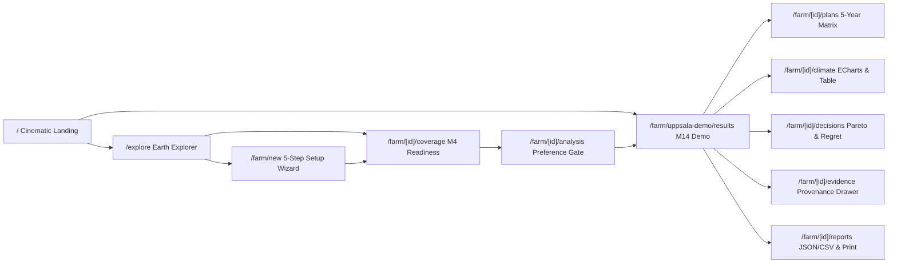

# ASTRAGRON — Product Flows Reference (`PRODUCT_FLOWS.md`)

See also [UX_AND_PAGE_ARCHITECTURE.md](./UX_AND_PAGE_ARCHITECTURE.md) for the complete route table and failure state matrix.

## Primary User Flow Diagram

